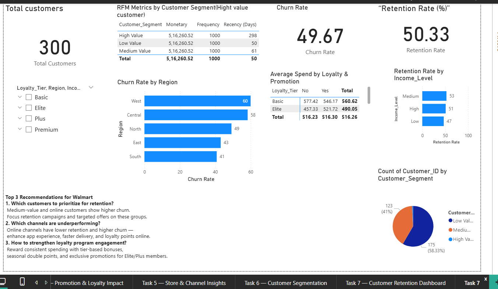
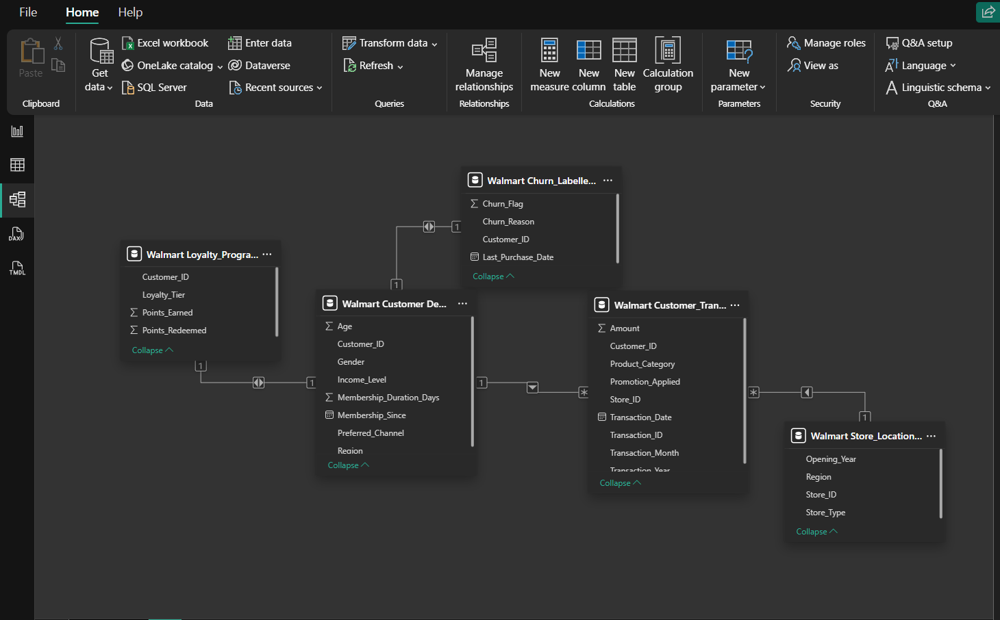
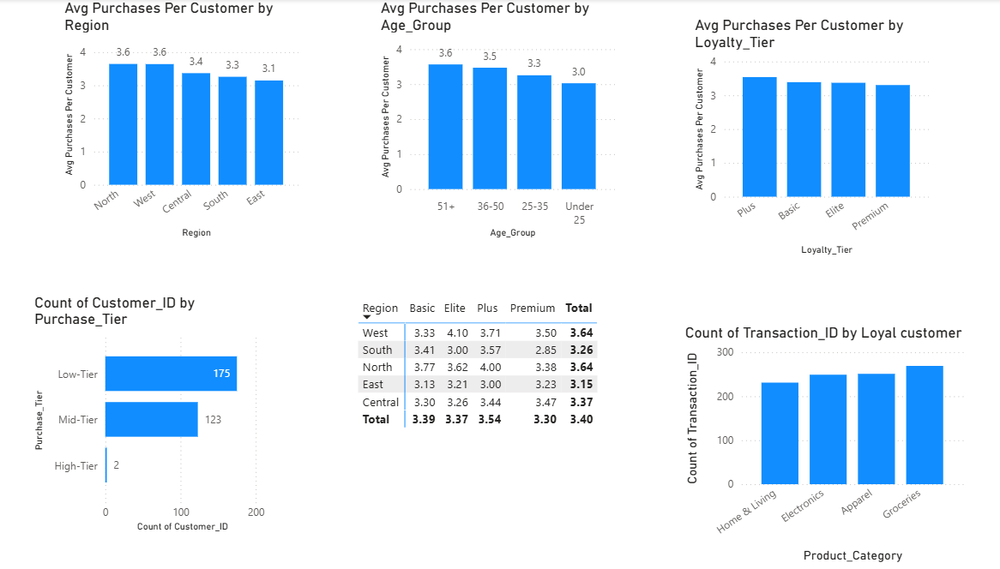
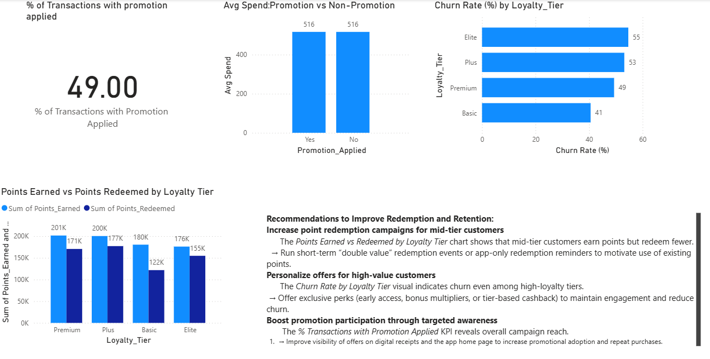
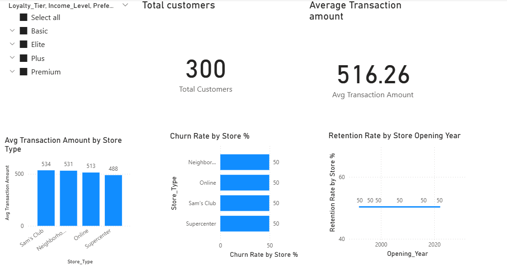
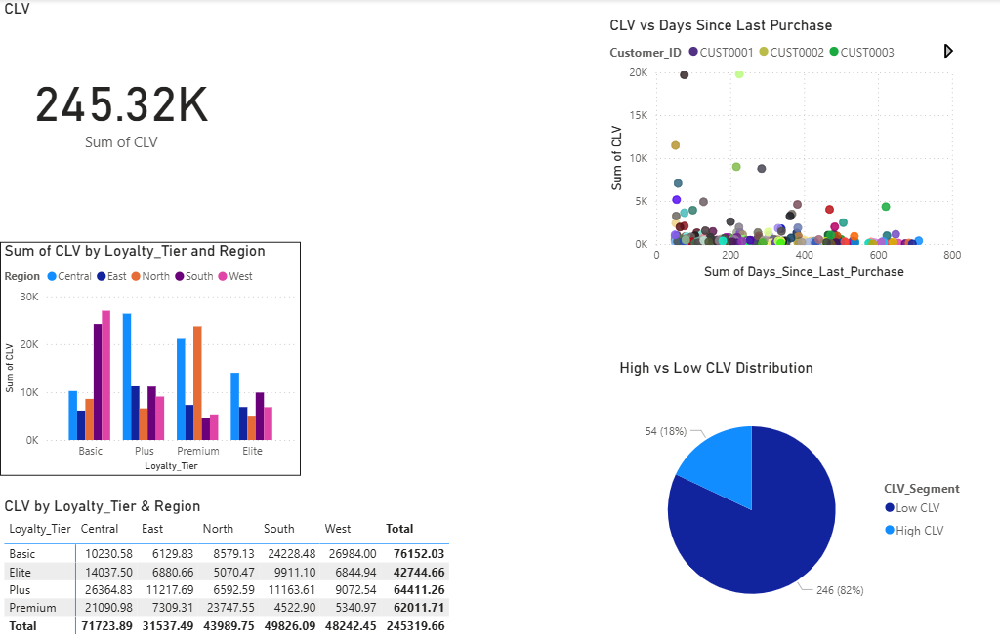

# 🛒 Walmart Customer Retention & CLV Dashboard (Power BI)

An interactive Power BI dashboard that analyses customer churn, retention, loyalty and lifetime value for a Walmart-style retail dataset, and turns the findings into retention recommendations.

**Tools:** Power BI · Power Query · DAX · Data Modeling
**Walkthrough video:** [Watch here](https://drive.google.com/file/d/10b6yF2NqdTw9BH96ZClh1YW8fC7F02mF/view?usp=sharing)

---

## 🎯 Business Questions
1. Which customers should be prioritised for retention?
2. Which regions, channels and loyalty tiers have the weakest retention?
3. Do promotions and loyalty programmes actually change spending?
4. Which customers are the most valuable (CLV / RFM)?

## 🗂️ Data Model
Five related tables (300 customers) cleaned and linked in Power Query / the Power BI model:
customer details · loyalty programme · transactions · churn labels · store locations.

## 🧮 What I Built
- **Data cleaning & modelling:** removed unused columns, handled missing values, created one-to-many relationships across all five tables.
- **DAX measures:** total / churned / repeat customers, churn rate, retention rate, purchase tiers, average purchase frequency, % of transactions with a promotion, average spend with vs without promotion, points earned vs redeemed, CLV, CLV segments, days since last purchase.
- **7 report pages:** modelling, churn & retention, repeat purchase, promotion & loyalty, store & channel, CLV segmentation, final dashboard with slicers.

## 📊 Key Findings
| Area | Finding |
|---|---|
| Overall | Churn rate **49.67%**, retention **50.33%** across 300 customers |
| Region | Churn is highest in the **West (60%)** and **Central (58%)** and lowest in the **South (41%)** |
| Loyalty tier | **Elite (55%)** and **Plus (53%)** churn more than **Basic (41%)**, so loyalty tier alone does not prevent churn |
| Promotions | 49% of transactions used a promotion, but average spend was almost identical with and without one (~516) |
| Loyalty points | **Basic** members redeem the least of what they earn (~122K of 180K points) |
| CLV | Total CLV ≈ **245K**; only **18% (54 customers)** are high-CLV, so value is concentrated |
| Stores | Average transaction value is similar across store types (≈ 488–534) |

## 💡 Recommendations
1. **Target high-churn regions first (West, Central)** with retention offers.
2. **Re-think the Elite / Plus tiers:** they churn more than Basic, so add tier-specific perks such as early access or bonus multipliers.
3. **Run point-redemption campaigns for Basic members**, who leave the most points unused.
4. **Protect the ~18% high-CLV customers** with personalised offers, and test whether current promotions actually lift spend, since they showed no difference.

## 📁 Files
- `Walmart_project.pbix` – Power BI report
- `Walmart_Project_Report.docx` – step-by-step report with all DAX and screenshots
- `images/` – dashboard screenshots

## 👩‍💻 Author
**Lakshita** · MCA (Data Analytics)
[GitHub](https://github.com/stakefire99) · [LinkedIn](PASTE-YOUR-CORRECT-LINKEDIN-URL-HERE)
